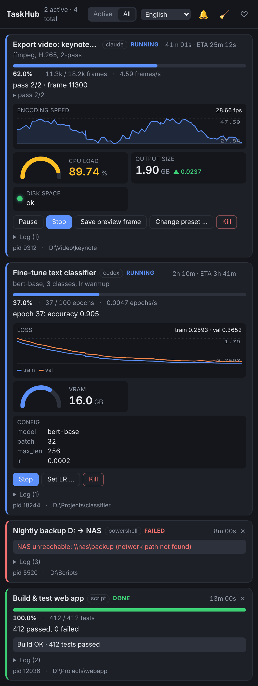
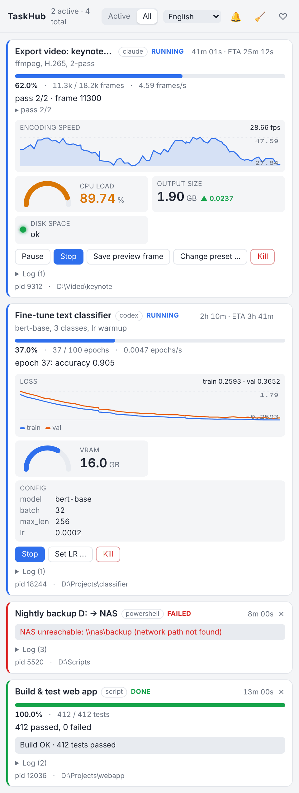

# TaskHub

[](https://github.com/FelixMUrphy/TaskHub/actions/workflows/ci.yml)

**One place to watch and control everything that runs in the background on your Windows PC** — training runs,
simulations, renders, builds, backups, and the scripts your AI agents (Claude, Codex, ChatGPT) start for you.

Any process reports progress over a tiny local HTTP API and gets a tray icon, Windows notifications and a pop-up panel
with live charts, gauges and **its own buttons** (pause, change a parameter, save a snapshot, kill). No cloud, no account,
loopback only.

<p align="center">
  
  
</p>

[**⬇ Download the latest setup.exe**](https://github.com/FelixMUrphy/TaskHub/releases/latest) ·
[API reference](API.md) · [❤ Sponsor](https://github.com/sponsors/FelixMUrphy)

> **AI agent reading this?** Claude Code / Codex: use the TaskHub **MCP tools** (`task_start`, `notify`, …). If you don't
> see them, don't use `curl` - ask the user to enable *TaskHub tools (MCP)* (tray → *AI agents*) and to start a new
> session. Details: [API.md → AI agents](API.md#ai-agents-read-this-first).

## Why
- You start a 6-hour job and want to know when it finishes, fails or hangs — without watching a console.
- An AI agent launches long scripts for you; TaskHub gives them one documented way to report status and to receive your
  commands back ("lower the learning rate", "stop after this epoch").
- Several things run in parallel and you want one glance at all of them.

## Features
- **Tray icon** with a progress ring and the number of active tasks; colour shows running / stalled / failed / done.
- **Panel** (click the tray icon): every task with progress, ETA, status, log and widgets — line/area/bar charts, gauges,
  stats with deltas, LEDs, key-value lists, tables, text.
- **Controls declared by the task itself**: buttons, number/text/select inputs, confirmations, shell commands,
  open-file/folder, graceful stop, pause/resume, kill. Values go back to the process over long-polling.
- **Windows notifications** on finish / failure / stall by default; start, milestone (plain) and log notifications on
  request; the task's buttons and input fields in notifications if it asks; a live progress notification; quiet while the
  panel is open.
- **Claude Code and Codex in one click**: TaskHub tools for the agent (MCP) and "finished / needs your permission"
  notifications (hooks) — see [below](#claude-code-and-codex-one-click).
- **Telegram**: the same notifications on your phone through your own bot, with the task's buttons; a live progress
  bar per task and its charts when it finishes; `/tasks`, `/mute` (optionally only when you are away from the PC) —
  see [Telegram](#telegram).
- **Stall detection** (heartbeat timeout) and *lost* state when the process dies.
- **Agent-friendly**: an MCP server (`taskhub mcp`), a native `taskhub` CLI on PATH, a stdlib-only Python client,
  plain HTTP for everything else; `taskhub api` prints the docs an agent needs.
- **Update check**: a notification when a new version is released (once a day; tray → *Updates*).
- 10 UI languages (English, Українська, Español, Deutsch, Français, Italiano, Português, Polski, 中文, 日本語).
- Per-user install, no admin rights, no .NET runtime needed; self-healing autostart.

## Quick start
1. Run `TaskHub-<version>-setup.exe` → **Install** (choose a folder, autostart, PATH and the Claude Code / Codex options).
2. Report something:

```powershell
taskhub notify "Render" "finished in 42 min"
taskhub run --name "Build" -- cmake --build build -j 16     # wraps any command, parses % from its output
```

```python
from taskhub_client import Task, W, C          # stdlib only; installed next to taskhub.exe

with Task("Train", total=100, unit="epochs", source="codex",
          widgets=[W.chart("loss", "Loss", series=["train", "val"]), W.gauge("vram", "VRAM", max=24, unit="GB")],
          controls=[C.signal("lr", "Set LR", input=C.number(default=1e-3))], pausable=True) as t:
    t.on("lr", lambda v: set_lr(v))
    for e in range(100):
        t.wait_if_paused()
        if t.stop_requested: break
        t.progress(e + 1, status=f"epoch {e+1}", widgets={"loss": {"train": tl, "val": vl}, "vram": mem})
```

```bash
curl -s -X POST localhost:47800/api/notify -H "X-TaskHub: 1" -d '{"title":"Done","message":"backup ok"}'
```

**With AI agents** — Claude Code and Codex: enable *TaskHub tools (MCP)* (next section), nothing else to do. Other
agents (ChatGPT, scripts, any tool with a shell) — add one line to `AGENTS.md` / custom instructions:

> For any job longer than a minute, report it to TaskHub (`taskhub api` prints the docs; wrap commands with
> `taskhub run --name ... -- <cmd>`).

### Claude Code and Codex: one click
The setup dialog (and later the tray menu → *AI agents*) has two independent options per agent:

| Option | What you get | Where TaskHub writes |
|---|---|---|
| **Notifications (hooks)** | a toast when the agent finishes a response or needs your permission | Claude Code: `~/.claude/settings.json` · Codex: `~/.codex/hooks.json` |
| **TaskHub tools (MCP)** | the agent gets tools `notify`, `task_start/update/finish`, `task_commands`, `task_list` and shows its long jobs in the panel by itself | Claude Code: `~/.claude.json` · Codex: `~/.codex/config.toml` |

TaskHub adds — and on uninstall removes — only its own entries and keeps everything else (backup of the original:
`*.taskhub.bak`). What to do in the agent afterwards:

- **Claude Code** — start a new *local* session (desktop app → Code tab → environment *Local*, the CLI or VS Code).
  `/mcp` should list `taskhub` as connected. Cloud sessions run on Anthropic's servers and can't reach TaskHub on your PC.
- **Codex** — restart Codex. Hooks: Codex → Settings → Hooks → *Trust all* (Codex asks once for new hooks).
  MCP: the `taskhub` server should appear among Codex's MCP servers.

Scripted: `TaskHubHost.exe --integrations claude=on codex=on claude-mcp=on codex-mcp=off`. Manual setup:
[API.md → Claude Code hooks](API.md#claude-code-hooks), [Codex hooks](API.md#codex-hooks), [MCP server](API.md#mcp-server).

### Telegram
Tray menu → *Telegram…*: create a bot with [@BotFather](https://t.me/BotFather) (`/newbot`), paste its token, press
*Connect*, scan the QR code with your phone (or open the link on this PC) and press *Start* (in a private chat with the bot:
groups can't be linked, since every member could press the tasks' buttons). To link another account
later (e.g. the one on your phone), leave the token field empty and press *Connect* again. From then on every notification TaskHub shows also arrives in
that chat (only that chat can talk to the bot); a task's notification buttons become inline buttons — including
select options and yes/no; number / text inputs: the bot asks for the value and your reply goes to the task — and presses
go back to the task. A task with progress gets one silent message with a progress bar, ETA, status and the task's
buttons that is edited in place (no new message per update); when the task finishes, its charts arrive
as one picture (option *Progress and charts*, `telegram_progress`). Commands: `/tasks`, `/mute`, `/unmute`. Option: send only
when you are away from the PC (no keyboard / mouse for 5 min, `telegram_away_minutes` in `config.json`). The bot token
is stored in `%APPDATA%\TaskHub\config.json`; messages go from your PC straight to Telegram's Bot API.

## Install details
The setup dialog installs to `%LOCALAPPDATA%\Programs\TaskHub` by default (or any folder you choose), unpacks the
`taskhub` CLI, `taskhub_client.py` and `API.md`, registers `taskhub://` and an *Apps & features* entry. Over an existing
install the setup shows the installed version and folder (the version is read from the installed exe) and offers
**Update**, **Reinstall** (same version) or installing the older version, keeping the folder, autostart and PATH choice. *Run without installing* is also available.

- Silent: `TaskHub-<version>-setup.exe --install [--dir PATH] [--no-autostart] [--no-path] [--claude|--no-claude]
  [--codex|--no-codex] [--claude-mcp|--no-claude-mcp] [--codex-mcp|--no-codex-mcp] --quiet` (agent options not given stay unchanged)
- Uninstall: *Apps & features* → TaskHub, or `TaskHubHost.exe --uninstall [--quiet] [--purge]`
  (`--purge` also deletes the data in `%APPDATA%\TaskHub`). Also removes TaskHub's entries from the Claude Code / Codex settings.
- Autostart restores itself (also if disabled in Task Manager) unless you turn it off in the tray menu.
- Requirements: Windows 10 1809+ / 11 x64, WebView2 runtime (preinstalled on current Windows).
- Port 47800, `127.0.0.1` only, CSRF header + Host/Origin checks; optional bearer token (`"token"` in `config.json`).

Updates: once a day the installed hub looks up the latest release on GitHub (one request to `api.github.com`, nothing is
downloaded or installed) and shows a notification when a newer version is out; tray → *Updates* has *Check now* and the
*Check daily* switch (`"update_check": false` in `config.json`). Run the new setup.exe to update.

Toast timing: `toast_seconds` / `toast_seconds_interactive` (4 s / 8 s) in `config.json`; afterwards notifications stay
in the notification center.

## Build from source
`build.cmd` (needs the .NET 8 SDK) → `dist\TaskHub-<version>-setup.exe` (single self-contained file; the CLI is built
first and embedded) and `app\` for development. Sources: `src\Host` (Kestrel HTTP API, WinForms tray, WebView2 panel,
WinRT toasts), `src\Cli`, `ui.html`, `clients\python`.

Microsoft Store edition: after `build.cmd`, `packaging\build-msix.ps1` → `dist\TaskHub-<version>.msix` (unsigned; the
Store signs it; `-Name` / `-Publisher` / `-PublisherDisplay` from Partner Center). Same code: in the package TaskHub
has no setup or update check of its own, and autostart, `taskhub://` and the `taskhub` command come from
`packaging\AppxManifest.xml`. `-Register` installs the build folder as a package for testing (Developer Mode).
Only one edition at a time: the Store edition offers to remove a setup-exe installation (or, with "Keep both", turns
its own autostart off), and the setup exe offers to replace the Store edition. Both use the same data folder and agent
connections; the package writes to the real `%APPDATA%` and `HKCU` (`unvirtualizedResources`).

Tests: `tests\run_tests.cmd` starts an isolated hub (port 47899, temp data, no tray, no notifications) and runs
`api_test.py` (API contract, agent hooks, CLI), `validation_test.py` (input validation: non-finite numbers, widget attributes, control values, shell controls), `parallel_test.py` (8 concurrent workers + notification burst),
`integration_test.py` (Claude Code / Codex settings edits, in a temporary home folder), `mcp_test.py` (`taskhub mcp`) and
`telegram_test.py` (Telegram bridge against a mock Bot API).
Every push runs the build and these tests on GitHub Actions (`.github/workflows/ci.yml`, Windows runner); pushing a tag
`v<version>` (matching `Settings.Version`, `build.cmd` and both `.csproj`) also publishes the release with the setup exe
and its SHA-256.
`tests\demo_long.py` is an interactive ~20 min demo against the main hub.

Hub command line: `TaskHubHost.exe [--port N] [--data DIR] [--install|--uninstall [--quiet] [--purge] | --status |
--panel [ID] | --integrations [claude|codex|claude-mcp|codex-mcp=on|off ...] | --no-tray]`. A `TaskHubHost.settings.json` next to the exe (`{"port": 47801, "data": "..."}`) runs an
independent second instance.

## Support
TaskHub is free. If it saves you time, [sponsoring](https://github.com/sponsors/FelixMUrphy) keeps it maintained —
and tells me which ideas are worth building next. Bug reports and feature requests: [Issues](https://github.com/FelixMUrphy/TaskHub/issues).

## License
[PolyForm Shield 1.0.0](LICENSE.md) — source-available: free to use, modify and share for any purpose, including at
work, **except** to provide a product that competes with TaskHub (e.g. repackaging or reselling it).
